```
```

<a href="https://pedrocamara.vercel.app">
  
</a>

<br>

I'm focused on LLM applications, agents and RAG. I work to take language models from prototype to production, with continuous evaluation, cost and latency control, and decisions driven by data rather than intuition. I built Senderix, a WhatsApp automation SaaS with AI applied to customer service, along with the eval system that guards the quality of its models, featuring a golden dataset, LLM-as-a-judge and regression detection in CI. Today I'm dedicated to building agents, RAG pipelines and AI solutions that actually work in the real world.

<br>

<picture>
  <source media="(prefers-color-scheme: light)" srcset="assets/label-projects-light.svg">
  
</picture>

<a href="https://github.com/pedroatilagc/senderix-eval">
  
</a>

<p>
  <a href="https://github.com/pedroatilagc/rag-customer-support"></a>
  <a href="https://senderix.com.br"></a>
</p>

<br>

<picture>
  <source media="(prefers-color-scheme: light)" srcset="assets/label-stack-light.svg">
  
</picture>



<br>

<picture>
  <source media="(prefers-color-scheme: light)" srcset="assets/label-now-light.svg">
  
</picture>



<br>

<picture>
  <source media="(prefers-color-scheme: light)" srcset="assets/label-activity-light.svg">
  
</picture>

<picture>
  <source media="(prefers-color-scheme: dark)" srcset="https://raw.githubusercontent.com/pedroatilagc/pedroatilagc/output/snake-dark.svg">
  
</picture>


<p>
  <a href="https://pedrocamara.vercel.app"></a>
  <a href="https://www.linkedin.com/in/pedrocâmara"></a>
  <a href="mailto:pedroatilagc@gmail.com"></a>
</p>
